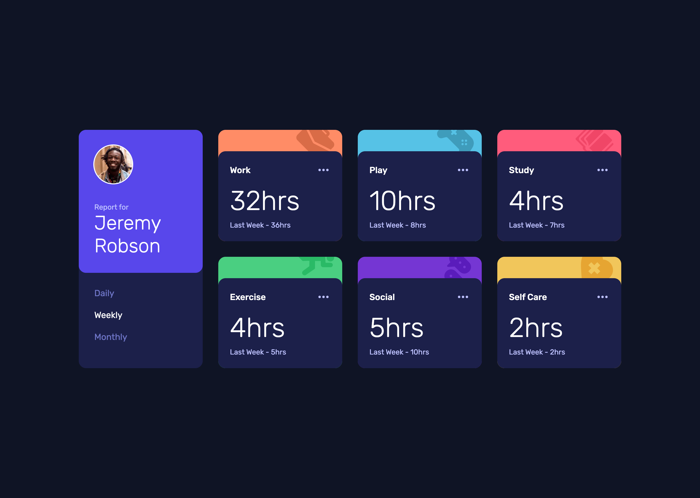

# Frontend Mentor - Time tracking dashboard solution

This is a solution to the [Time tracking dashboard challenge on Frontend Mentor](https://www.frontendmentor.io/challenges/time-tracking-dashboard-UIQ7167Jw). Frontend Mentor challenges help you improve your coding skills by building realistic projects.

## Table of contents

- [Overview](#overview)
  - [The challenge](#the-challenge)
  - [Screenshot](#screenshot)
  - [Links](#links)
- [My process](#my-process)
  - [Built with](#built-with)
  - [What I learned](#what-i-learned)
  - [Continued development](#continued-development)
  - [Useful resources](#useful-resources)
  - [AI Collaboration](#ai-collaboration)
- [Author](#author)

## Overview

### The challenge

Users should be able to:

- View the optimal layout for the site depending on their device's screen size
- See hover states for all interactive elements on the page
- Switch between viewing Daily, Weekly, and Monthly stats

### Screenshot



### Links

- Repo URL: [https://github.com/antoru/time-tracking-dashboard-main](https://github.com/antoru/time-tracking-dashboard-main)
- Live Site URL: [https://antoru.github.io/time-tracking-dashboard-main/](https://antoru.github.io/time-tracking-dashboard-main/)

## My process

### Built with

- Semantic HTML5 markup
- [Tailwind CSS v4](https://tailwindcss.com/) via `@tailwindcss/cli`, with custom design tokens (`@theme`) based on the challenge's style guide
- Mobile-first workflow, `md`/`lg` breakpoints
- CSS Grid / Subgrid
- Vanilla JavaScript, with `fetch` to load `data.json`
- Deploy with GitHub Actions on GitHub Pages

### What I learned

#### Aligning the header and the cards with subgrid

On desktop the profile sits on the left and the six cards on the right. At first I had two separate grids: `main` split into `1fr 3fr`, and `.cards` with its own three columns. The result was a header about 21px wider than the card columns, because each grid calculated its columns and gaps on its own.

I fixed it by making `.cards` use the columns of `main`, with subgrid:

```html
<main class="lg:grid lg:grid-cols-4 lg:gap-8">
	<header class="lg:row-span-2">...</header>
	<div
		class="cards grid gap-6 lg:col-span-3 lg:row-span-2 lg:grid-cols-subgrid lg:grid-rows-subgrid lg:gap-[inherit]"
	>
		...
	</div>
</main>
```

Something I didn't know: a subgrid only takes the parent's gap if it doesn't have one of its own. `.cards` had `gap-6` for mobile, and it stayed active on desktop too. With `lg:gap-[inherit]` it uses the same gap as `main`.

#### Loading the data only once, without global variables

An `init()` function runs `await getData()` and only then attaches the click listener. The handler can see `activities` thanks to the closure, and nobody can click before the data has arrived. A small experiment in the browser console made it clear to me: a closure keeps a link to the variable, not a copy of its value.

I also got it wrong once. I had moved `cardsContainer` inside `init()` and used it in `updateCards()`, which is written outside: the result was a `ReferenceError`. A function sees the variables of the place where it is written, not of the place it is called from. I fixed it by passing it as a parameter.

For the previous-period labels I used an object instead of a series of `if` statements:

```js
const previousLabels = {
	daily: 'Yesterday',
	weekly: 'Last Week',
	monthly: 'Last Month',
};
```

and then `previousLabels[period]`. Adding a new period only takes one line.

#### Lighthouse: not chasing every warning

My first reaction to the LCP warning was to preload all 7 images. But if everything has priority, nothing really does, so I kept only one: `icon-work.svg`. Then I preloaded the 300 font weight, the one used for the hours, remembering `crossorigin` (even though the file is on the same site). I converted the avatar to WebP at 2×: from 25.7 KB to 5.7 KB. I also learned to leave some warnings alone. The cache lifetime, for example, is decided by GitHub Pages, not by me.

### Continued development

I plan to keep building challenges and personal projects, both to grow my portfolio and to become a better developer. My next goal is to start using a modern framework (React or Next.js) and TypeScript. Only after that will I move to the backend, with the goal of understanding and building a full-stack project from start to finish.

As my first concrete experiments, I want to come back to this same dashboard:

- **Rebuild the cards in React** as a single component generated from `data.json`. Right now the 6 cards are written by hand in the HTML, and each one has a `data-title` I have to keep in sync with the JSON.
- **Add TypeScript**, with types for the data and for the selected period. During the project I wrote `data-period="Daily"` instead of `"daily"` and only noticed it in the browser. I want to see whether types catch mistakes like this earlier.

### Useful resources

- [google-webfonts-helper](https://gwfh.mranftl.com/fonts) - To download Rubik as woff2 files with a ready-made `@font-face` snippet.
- [Tailwind CSS v4 documentation](https://tailwindcss.com/docs/theme) - To set up colors and fonts with `@theme` directly in the CSS.

### AI Collaboration

I used Claude Code in the terminal. With the challenge's `AGENTS.md` file it acted as a mentor: I wrote the HTML, CSS and JavaScript myself, while Claude reviewed my code, asked me questions and explained the reasons behind things, often suggesting a small experiment in the console or in DevTools.

At my request it handled two infrastructure tasks directly: the Tailwind v4 setup with the CLI and the GitHub Actions workflow for deployment. It also helped me write this README, based on what I had done during the project.

What worked: it helped me find mistakes I wouldn't have spotted on my own, like the `data.json` path, the guard clause in the wrong order and the 7 preloads. It didn't give me the solution, so I had to understand every fix.

What didn't work: sometimes the answers were long when a yes or no was enough, and some functions took many rounds of review. Next time I'll explicitly ask for a short answer when that's all I need.

## Author

- GitHub - [antoru](https://github.com/antoru)
- LinkedIn - [antoru](https://www.linkedin.com/in/antoru/)
- Frontend Mentor - [@antoru](https://www.frontendmentor.io/profile/antoru)
